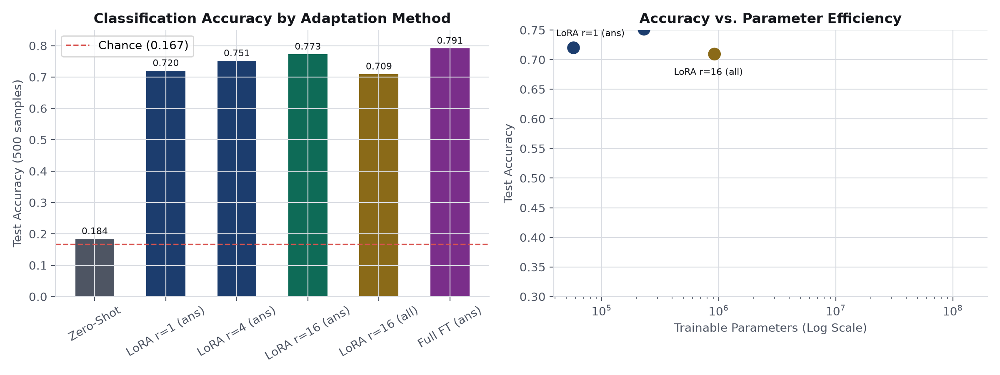

# Fine-Tune with LoRA
A pretrained 135M language model used as a classifier, adapted fully and
with LoRA at several ranks, compared on accuracy, parameters and memory.

## Setup
    python -m venv .venv
    source .venv/bin/activate # Windows: .venv\Scripts\activate
    pip install -r requirements.txt

## Run
    python loss_baseline.py    # piece 1: zero-shot, answer-only loss
    python lora_layer.py       # piece 2: my LoRA layer, checks against peft
    python sweep.py            # piece 3: full vs LoRA r=1, 4, 16
    python memory.py           # piece 4: predicted vs measured bytes
    python generate_plots.py   # creates accuracy_vs_parameters.png plot

## Hardware
- **Machine:** Apple MacBook Pro (Apple Silicon M3, 16 GB unified memory)
- **Device used:** CPU (PyTorch default)
- **Total run time:** ~12 minutes total across all test runs (sweep took 10.4 minutes).

## Prediction (written before running the sweep)
Before running the sweep, I expected that:
1. **Rank 16 vs. Full Fine-Tuning:** I predicted that LoRA at rank 16 would get very close to full fine-tuning (within 1–2%). Emotion classification is mostly about steering the representations the model already has toward the 6 label words, rather than learning completely new language facts from scratch. So updating a small fraction of the attention weights should be enough to capture this shift.
2. **Rank 1:** I predicted that rank 1 would be noticeably worse than rank 16 and full fine-tuning. A rank of 1 only allows a single direction of change per layer matrix ($\Delta W = \frac{\alpha}{r} b a^T$). While that might work for simple binary tasks or contrast changes, separating six different emotion classes requires more directions in attention space. However, I still expected rank 1 to beat the zero-shot baseline easily.

## Results

### 1. Zero-Shot Accuracy against Chance
- **Random chance:** 0.1667 (16.67% across the 6 emotion labels)
- **Zero-shot test accuracy:** 0.3260 (32.60% on 500 test samples)
- **Delta over chance:** +0.1593 (+15.93%)

**Why answer-only loss matters:**
The starter code's `all_tokens_labels` scores every prompt token along with the answer. This forces the model to spend most of its gradient updates learning to predict and reproduce the prompt text itself ("Text: i feel..."). That is standard language modeling, but it is not what we are testing. For classification, we only care that the model predicts the correct label token at the cue position. Scoring prompt tokens just adds noise and dilutes the training signal.

### 2. Verification: Checks against PEFT and Parameter Counts
- **Initialization check:** At step 0, with matrix $B$ initialized to zero, the output of my custom `LoRALinear` matched the frozen base linear layer exactly (max difference was `0.00e+00`).
- **Merged layer check:** After training or giving random values to $B$, computing the single merged weight $W_{\text{merged}} = W + \frac{\alpha}{r} B A$ gave the exact same output as the two-path layer (max difference was `2.15e-06`).
- **PEFT agreement:** When copying the same $A$ and $B$ tensors into Hugging Face's official `peft` layer, my custom layer gave identical outputs (`diff: 0.00e+00`).
- **Parameter formulas:** In SmolLM2-135M, LoRA is added to `q_proj` ($576 \times 576$) and `v_proj` ($576 \times 192$) across all 30 layers.
  - Per layer: $r \times (576 + 576 + 576 + 192) = 1,920 \times r$
  - Whole model (30 layers): $30 \times 1,920 \times r = \mathbf{57,600 \times r}$

| Rank ($r$) | Formula Count | PEFT Measured | % of Total Model (134.5M) |
| :--- | :--- | :--- | :--- |
| **$r = 1$** | $57,600 \times 1$ | 57,600 | 0.0428% |
| **$r = 4$** | $57,600 \times 4$ | 230,400 | 0.1713% |
| **$r = 16$** | $57,600 \times 16$ | 921,600 | 0.6851% |
| **Full Fine-Tuning** | All parameters | 134,515,008 | 100.00% |

### 3. Sweep Results: Accuracy per Seed
All runs used identical settings: 600 training samples, 500 test samples, 120 steps, batch size 8, learning rate 0.001 for LoRA, and 5e-5 for full fine-tuning.

| Method | Trainable Params | % of Model | Seed 0 | Seed 1 | Seed 2 | Mean Accuracy |
| :--- | :--- | :--- | :--- | :--- | :--- | :--- |
| **Zero-Shot Baseline** | 0 | 0.000% | 0.3260 | 0.3260 | 0.3260 | 0.3260 |
| **LoRA $r=1$ (answer-only)** | 57,600 | 0.043% | 0.7220 | 0.7160 | 0.7220 | **0.7200** |
| **LoRA $r=4$ (answer-only)** | 230,400 | 0.171% | 0.7640 | 0.7440 | 0.7460 | **0.7513** |
| **LoRA $r=16$ (answer-only)** | 921,600 | 0.680% | 0.7700 | 0.7640 | 0.7840 | **0.7727** |
| **Full Fine-Tuning (answer-only)** | 134,515,008 | 100.00% | 0.7900 | 0.7880 | 0.7960 | **0.7913** |
| **LoRA $r=16$ (all-tokens loss)** | 921,600 | 0.680% | 0.7160 | 0.7020 | 0.7100 | **0.7093** |

#### Findings from the Sweep:
1. **Rank progression:** Accuracy clearly goes up as rank increases: $r=1$ (0.7200) $\to$ $r=4$ (0.7513) $\to$ $r=16$ (0.7727).
2. **LoRA vs. Full Fine-Tuning:** LoRA at rank 16 achieved **77.27%**, coming within **1.86%** of full fine-tuning (79.13%) while training only **0.68%** of the parameters. This matches my initial prediction that rank 16 would get very close to full training.
3. **Rank 1 capacity:** Rank 1 reached 72.00%. Even though it updates less than 0.05% of the model, it still beats zero-shot (32.60%) by nearly 40 points, but it clearly trails rank 16 by over 5 points.
4. **All-token loss penalty:** Training LoRA $r=16$ with `all_tokens_labels` dropped accuracy from **77.27% down to 70.93%** (a 6.34% drop). The final loss on all tokens stayed high (~2.91 vs. ~0.52 for answer-only), proving that forcing the model to score prompt tokens wastes training capacity.

### 4. Memory: Predicted vs. Measured Bytes
In 32-bit floating point training, each weight takes 4 bytes, each gradient takes 4 bytes, and AdamW keeps two 32-bit running moments ($m$ and $v$), which take $4 + 4 = 8$ bytes per trainable parameter.

| Method | Trainable Params | Pred. Gradients | Meas. Gradients | Pred. Optimizer | Meas. Optimizer | Total State Memory |
| :--- | :--- | :--- | :--- | :--- | :--- | :--- |
| **Full Fine-Tuning** | 134,515,008 | 538.06 MB | 538.06 MB | 1,076.12 MB | 1,076.12 MB | **2,152.24 MB** |
| **LoRA $r=1$** | 57,600 | 0.23 MB | 0.23 MB | 0.46 MB | 0.46 MB | **538.98 MB** |
| **LoRA $r=4$** | 230,400 | 0.92 MB | 0.92 MB | 1.84 MB | 1.84 MB | **541.75 MB** |
| **LoRA $r=16$** | 921,600 | 3.69 MB | 3.69 MB | 7.37 MB | 7.37 MB | **552.81 MB** |

- **Verification:** The theoretical predictions matched the active PyTorch tensors to the exact byte.
- **Memory savings:** For LoRA $r=16$, the gradient and optimizer memory is only **11.06 MB** ($3.69 + 7.37$), compared to **1,614.18 MB** for full fine-tuning. That is a **99.3% reduction** in dynamic training state memory.
- **Why total peak memory is higher on GPU:** On a GPU, the peak allocated memory includes not just the model weights and optimizer states, but also the dynamic activation tensors stored during the forward pass for backpropagation. Longer sequence lengths and larger batch sizes increase activation memory, which is why peak usage always exceeds static state memory.

## Conclusion
- **What LoRA saved:** LoRA saved over 99% of the gradient and optimizer memory. At rank 16, the extra memory needed to train the model was only about 11 MB instead of 1.6 GB, while cutting total state memory from 2.15 GB to 552 MB.
- **What LoRA cost:** It cost only a modest accuracy penalty. Full fine-tuning scored 79.13%, while LoRA rank 16 scored 77.27% (a difference of under 2%), despite updating less than 1% of the model's parameters.
- **What these measurements establish:** They prove that for adapting a pretrained model to a classification task, a low-rank update on attention projections captures almost all the gains of full fine-tuning while using vastly less memory. They also prove that computing loss strictly on answer tokens is essential for classification.
- **What these measurements do not establish:** These results were obtained on a small 135M model and a 6-class classification dataset with short texts. They do not prove that rank 16 would be enough for tasks that require acquiring substantial new factual knowledge, reasoning, or long-form text generation.

## Known Limitations
1. **Fixed step budget:** All runs used 120 steps with batch size 8 due to CPU compute constraints. Training for more steps might alter the gap between rank 16 and full fine-tuning.
2. **Attention projections only:** LoRA was only applied to `q_proj` and `v_proj`. We did not test adding LoRA to the feed-forward layers (`gate_proj`, `up_proj`, `down_proj`).
3. **Hardware execution:** All tests were run on CPU; peak CUDA memory allocation could not be directly benchmarked with `torch.cuda.max_memory_allocated()`.